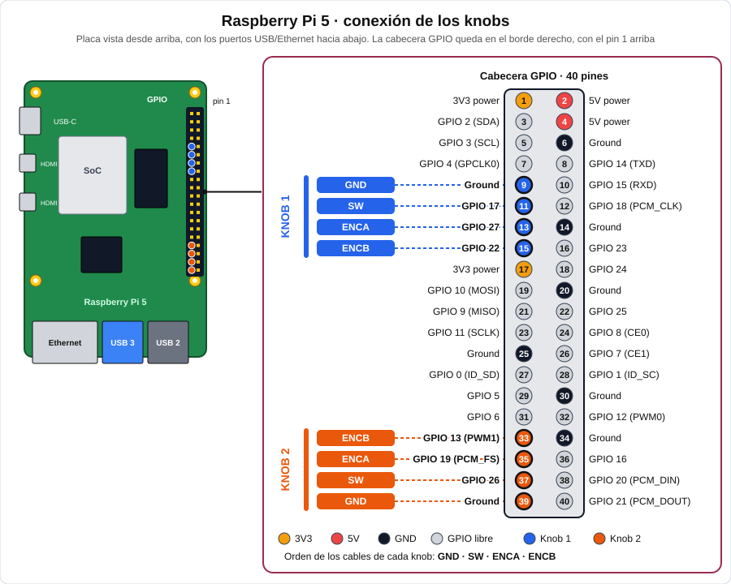
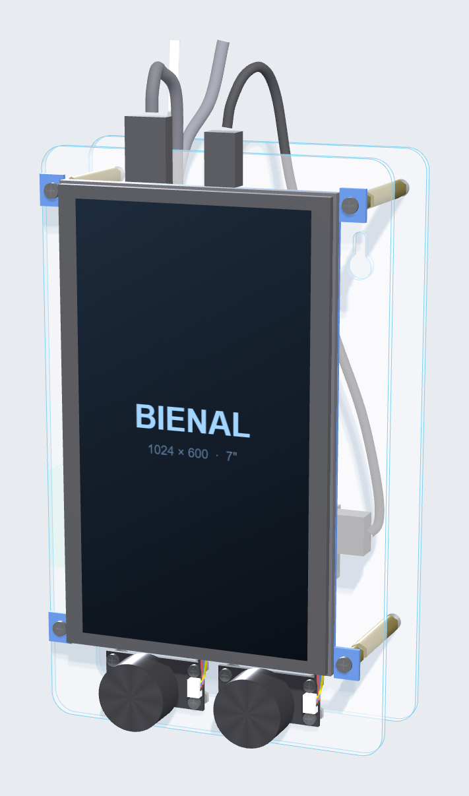
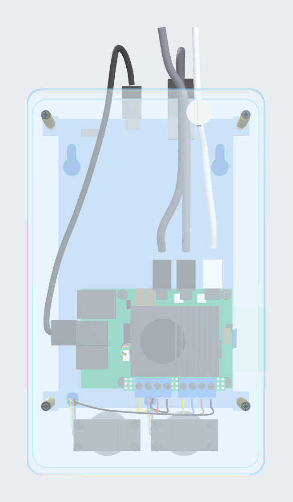
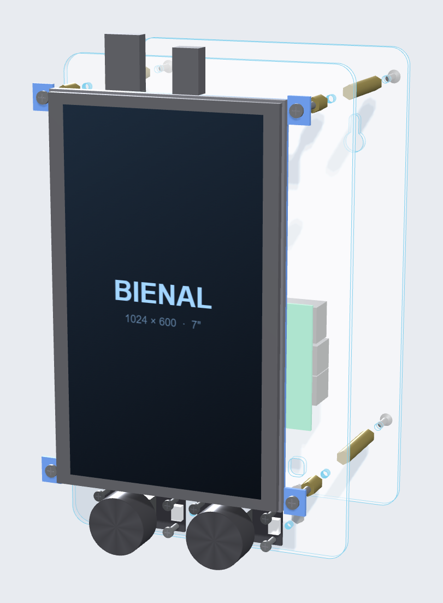
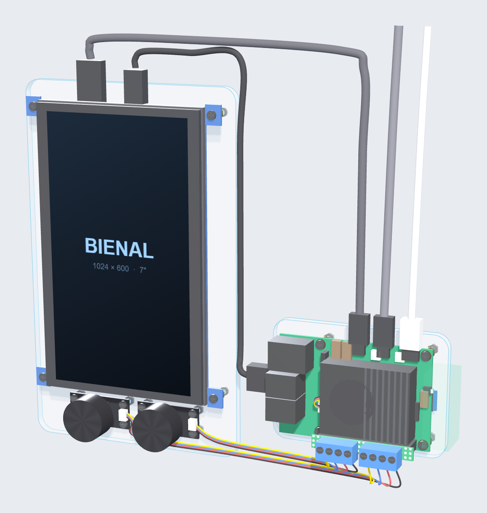
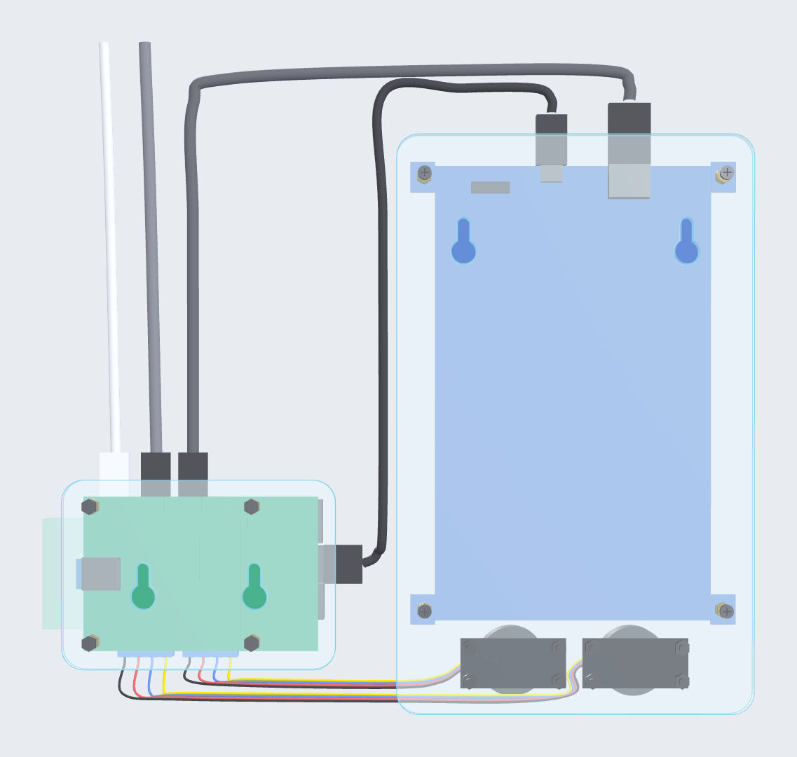

# Screen-Knobs

Pantalla táctil de 7" con **dos mandos giratorios** (encoder con pulsador) controlados por una **Raspberry Pi 5**.
Los sketches de **Processing** leen los mandos y los usan para manipular los visuales de la pantalla. Los mandos se leen con un script de Python (gpiozero) que lanza el propio sketch. El diseño de la carcasa es provisional.

---

## Funcionamiento del autostart

Al iniciar sesión en la Raspberry, el archivo `~/.config/autostart/p5.desktop` lanza el script `arrenca.sh`, que prepara las pantallas y abre los sketches.

**Desactivar:**

```
mv ~/.config/autostart/p5.desktop ~/.config/autostart/p5.desktop.disabled
```

**Volver a activarlo:**

```
mv ~/.config/autostart/p5.desktop.disabled ~/.config/autostart/p5.desktop
```

El cambio se aplica en el siguiente arranque.

---

## Contenido del repositorio

```
Screen-Knobs/
├── CARCASA/
│   └── carcasa_bienal_v2.html      Visor 3D interactivo de la carcasa (se abre en el navegador)
├── PYTHON/TestKnobPython/          Sketch de Processing con dos knobs
│   ├── TestKnobPython.pde          Sketch principal (esqueleto)
│   ├── Knob.pde                    Lanza knob.py y convierte sus mensajes en eventos
│   └── data/knob.py                Lee los GPIO con gpiozero y escribe K1 +1, K1 -1, K1 0...
└── docs/img/                       Capturas de la carcasa usadas en este README
```

---

<!-- Sección oculta de momento
## Hardware

| Pieza | Detalle |
|---|---|
| Raspberry Pi 5 | Con refrigerador activo oficial. Raspberry Pi OS 64 bits (Trixie), versión *sin* aplicaciones recomendadas |
| Pantalla | LCD HDMI 7" táctil (tipo Waveshare 7" C). Se usa girada 90° (vertical). *Pendiente de confirmar la resolución: el visor 3D indica 1024 × 600* |
| 2 × encoder | Pimoroni Picade Max Encoder: placa de 18 × 38 mm, agujeros M2,5 de 12 × 32 mm, conector JST-SH de 4 pines |
| Cables | 2 × JST-SH 4 pines → Dupont, micro-HDMI → HDMI, USB-A → micro-USB (táctil y alimentación de la pantalla), USB-C con fuente oficial de 27 W para la Pi |

El encoder no es I2C: aunque usa un conector JST-SH de 4 pines, no es compatible con Qw/ST, Qwiic ni STEMMA QT.
-->

---

## Conexión de los Knobs

Orden de los cables del encoder: **GND, SW, ENCA, ENCB**. Todos los pines de señal van con *pull-up* interno: el mando conecta el pin a GND.

**Mando 1** (pines físicos 9 a 15)

| Cable | Pin físico | GPIO (BCM) |
|---|---|---|
| GND | 9 | — |
| SW | 11 | 17 |
| ENCA | 13 | 27 |
| ENCB | 15 | 22 |

**Mando 2** (pines físicos 33 a 39)

| Cable | Pin físico | GPIO (BCM) |
|---|---|---|
| GND | 39 | — |
| SW | 37 | 26 |
| ENCA | 35 | 19 |
| ENCB | 33 | 13 |

**Esquema de conexión** (Raspberry Pi 5 vista desde arriba, con los puertos USB/Ethernet hacia abajo y la cabecera GPIO en el borde derecho):



`knob.py` usa exactamente estos pines (knob 1: 27, 22, 17 y knob 2: 19, 13, 26, en el orden ENCA, ENCB, SW). Si un mando gira al revés, intercambia sus pines A y B en `knob.py`.

---

## Software

Cada knob avisa al sketch de Processing con **eventos**: un paso en sentido horario, un paso en sentido antihorario o una pulsación. El sketch actual (`TestKnobPython.pde`) es un esqueleto que escribe en la consola cada evento que recibe.

### Cómo funciona (`PYTHON/TestKnobPython`)

1. **`data/knob.py`** usa **gpiozero**: un `RotaryEncoder` y un `Button` por knob, con callbacks. Escribe una línea por evento en la salida estándar:

```
K1 +1     (knob 1, un paso en sentido horario)
K1 -1     (knob 1, un paso en sentido antihorario)
K1 0      (botón del knob 1 pulsado)
```

   Lo mismo con `K2`. `RotaryEncoder` se crea con `max_steps=0` (sin límite) y los botones llevan `bounce_time=0.02` como antirrebote.

2. **`Knob.pde`** arranca `knob.py` como proceso hijo con `initKnobs()`. Un thread lee su salida y deja los eventos en una cola. La función `pre()`, que Processing ejecuta automáticamente antes de cada `draw()`, vacía la cola y llama a `knobTurned()` o a `knobPressed()`. Así esas funciones corren en el mismo thread que el dibujo.

3. **El sketch principal** solo tiene que llamar a `initKnobs()` en `setup()` y definir dos funciones. Dentro de ellas se pueden usar las variables `knobNum` (1 o 2) y `valor` (`+1` horario, `-1` antihorario):

```java
void setup() {
  size(400, 300, P2D);
  initKnobs();
}

void draw() {
}

void knobTurned() {
  if (knobNum == 1) {
    if (valor == +1) println("Knob 1: horario");
    if (valor == -1) println("Knob 1: antihorario");
  }
  // ... igual para knobNum == 2
}

void knobPressed() {
  if (knobNum == 1) println("Knob 1: pulsado");
  if (knobNum == 2) println("Knob 2: pulsado");
}
```

Las dos funciones, `knobTurned()` y `knobPressed()`, tienen que existir en el sketch principal aunque estén vacías.

### Notas

- **Dependencias:** `python3` y `gpiozero`. En Raspberry Pi OS con escritorio ya vienen instalados; en una instalación mínima: `sudo apt install python3-gpiozero`.
- **Cierre:** si el sketch se cierra, `knob.py` se cierra solo y libera los GPIO.
- **Pines ocupados:** `knob.py` no puede ejecutarse a la vez que otro programa que use los mismos GPIO. Si ya hay un sketch en marcha, `gpiozero` dará un error de pin ocupado.
- **Pasos por clic:** `RotaryEncoder` cuenta un paso por ciclo completo de las señales A y B. Conviene comprobar con el encoder real que un clic da un solo evento.
- **Dos knobs a la vez:** los callbacks de `gpiozero` pueden ejecutarse en threads distintos. Los eventos llegan a Processing en el orden en que se reciben y se entregan de uno en uno.
- **Exportar el sketch:** la carpeta `data/` se incluye en la exportación, así que `knob.py` viaja con la aplicación. En la Pi tienen que estar instalados `python3` y `gpiozero`.
- **Renderer:** `size(400, 300, P2D)` evita un error de dibujo que da el renderer por defecto en algunos Windows. Si en la Pi diera problemas, se puede volver a `size(400, 300)`.

---

## Carcasa (WIP - pendiente medidas exactas)

Carcasa abierta, sin caja: una plancha de metacrilato con la pantalla y los mandos por delante y la Raspberry por detrás, con su placa de prototipos (la Pi con la placa mide 27 mm de alto), y cerraduras para colgarla de la pared.

El archivo [`CARCASA/carcasa_bienal_v2.html`](CARCASA/carcasa_bienal_v2.html) es un visor 3D interactivo: se abre en el navegador, permite girar el modelo, ver la **explosión de montaje**, ocultar la pared y los cables, y consultar la lista de piezas con medidas (al pasar el cursor por una fila se resalta la pieza).

La opción elegida aparece en el visor como la variante **D**. Las medidas son las que da el propio visor (ancho × alto × fondo), sin cables.

### Opción 1 — 128 × 220 × 63 mm

Pantalla y mandos en una plancha frontal de metacrilato de 3 mm (128 × 208 mm). Los dos encoders van tumbados. La Raspberry va detrás, entre la plancha frontal y una placa trasera, también de metacrilato de 3 mm (mismo contorno), separadas por 4 separadores hexagonales M3 de 35 mm. La pantalla va a 10 mm de la plancha, sobre 4 separadores M3, y la Raspberry se fija con separadores macho-hembra, con una tuerca por delante que queda tapada por la pantalla. La lista completa está en [`CARCASA/MATERIALES.md`](CARCASA/MATERIALES.md). La placa trasera lleva 2 cerraduras para colgarla de la pared. Los cables HDMI y micro-USB de la pantalla llevan conectores rectos y rodean el borde superior de la plancha.

Valorar poner pasacables (o bridas) por detrás de la pantalla, para fijar mejor los cables HDMI y USB. 



| Trasera | Explosión de montaje |
|---|---|
|  |  |

<!-- Opción 2 oculta de momento
### Opción 2 — 248 × 220 × 42 mm

La Raspberry va en una placa aparte, a la derecha y más abajo. La plancha de pantalla y mandos ya no necesita placa trasera: es una sola plancha de 5 mm que se cuelga con 2 cerraduras ocultas tras la pantalla, y la Pi tiene las suyas bajo su placa. 

Valorar: Cableado visible




-->
