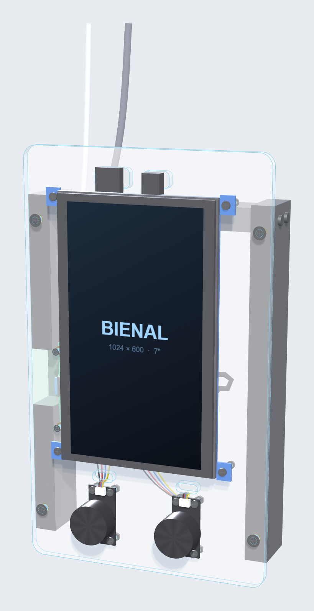
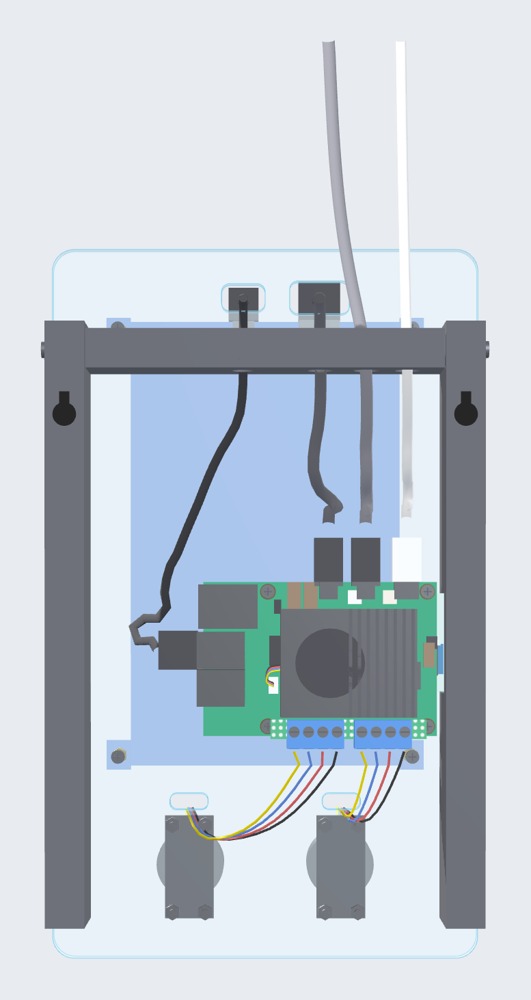
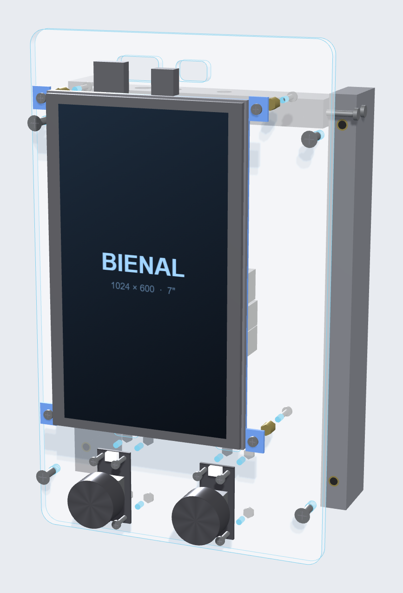
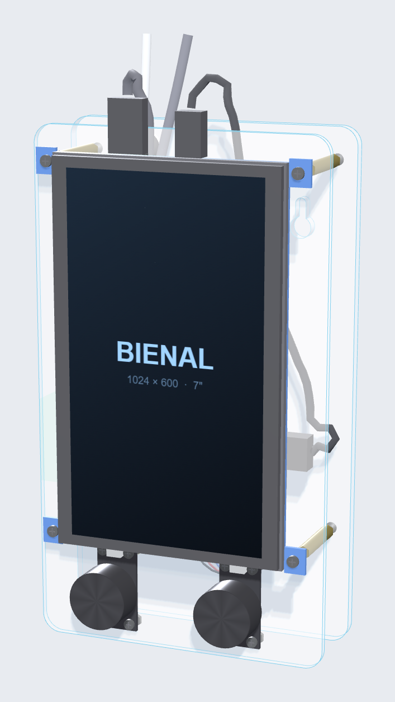
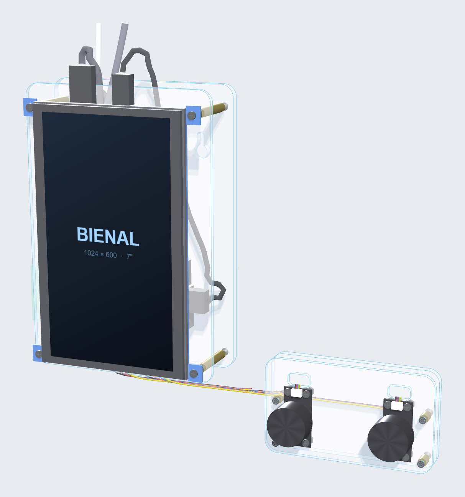
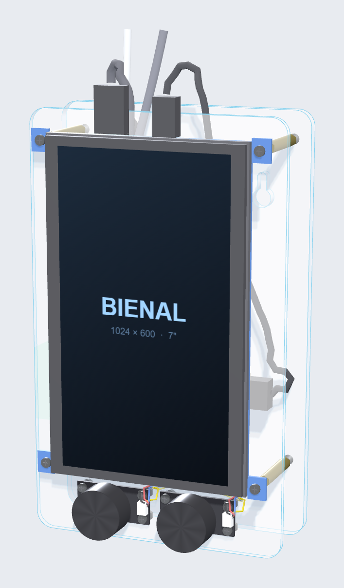
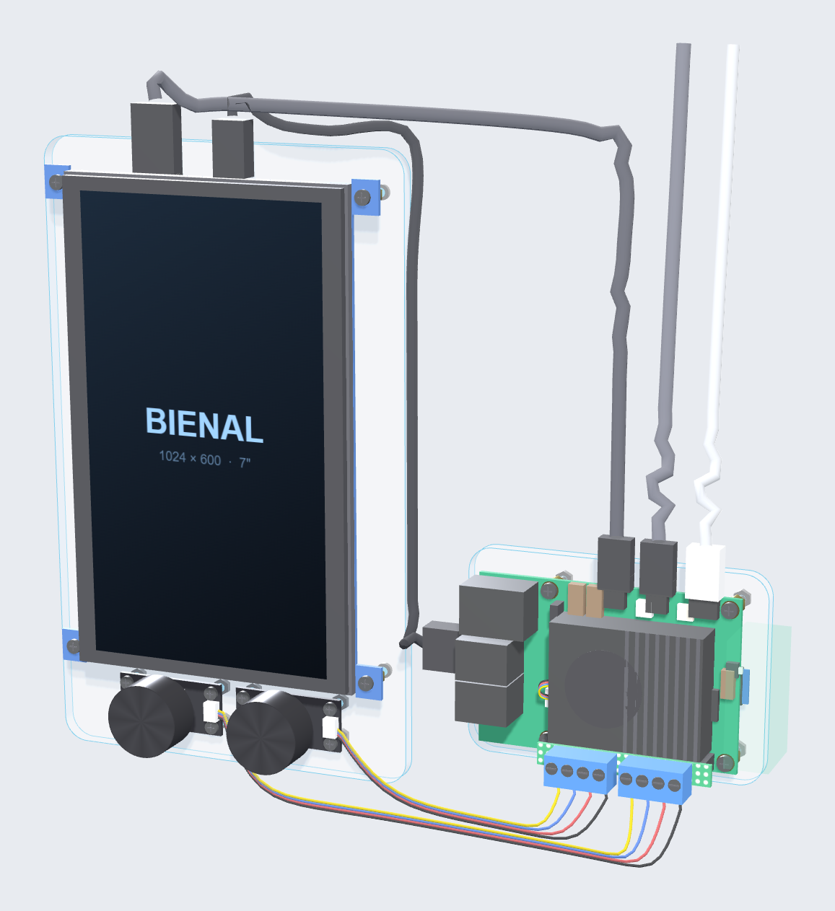

# Screen-Knobs

Pantalla táctil de 7" con **dos mandos giratorios** (encoder con pulsador) controlados por una **Raspberry Pi 5**.
Los sketches de **Processing** leen los mandos y los usan para manipular los visuales de la pantalla. Se incluyen dos formas de leer los mandos (Python y Java) y el diseño de la carcasa para la Bienal.

> Estado: pruebas de concepto. Cada sketch es un test que dibuja un círculo: el **mando 1** cambia su tamaño y el **mando 2** lo mueve en horizontal; pulsar un mando vuelve su valor a 0.

| Frente (variante A) | Detrás (variante A) |
|---|---|
|  |  |

---

## Contenido del repositorio

```
Screen-Knobs/
├── CARCASA/
│   └── carcasa_bienal_v2.html      Visor 3D interactivo de la carcasa (se abre en el navegador)
├── PYTHON/TestKnobPython/          Lectura de los mandos con Python (gpiozero)
│   ├── TestKnobPython.pde          Sketch principal (visuales)
│   ├── Knob.pde                    Lanza knob.py y recibe los valores
│   └── data/knob.py                Lee los GPIO y escribe "K1 5" / "K2 -3" por la salida estándar
├── JAVA/TestKnobJava/              Lectura de los mandos con Pi4J (Java)
│   ├── TestKnobJava.pde            Sketch principal (visuales)
│   ├── Knobs.pde                   Lectura de los GPIO con Pi4J
│   └── code/*.jar                  Pi4J 2.8.0 y SLF4J (Processing los carga solo)
├── docs/img/                       Capturas de la carcasa usadas en este README
└── terms_installa_pi_i_p5_fullscreen   Notas de instalación y arranque automático de la Raspberry
```

---

## Hardware

| Pieza | Detalle |
|---|---|
| Raspberry Pi 5 | Con refrigerador activo oficial. Raspberry Pi OS 64 bits (Trixie), versión *sin* aplicaciones recomendadas |
| Pantalla | LCD HDMI 7" táctil (tipo Waveshare 7" C). Se usa girada 90° (vertical). *Pendiente de confirmar la resolución: el visor 3D indica 1024 × 600, pero `arrenca.sh` fuerza 800 × 480* |
| 2 × encoder | [Pimoroni Picade Max Encoder](https://shop.pimoroni.com/en-eu/products/picade-max-encoder?variant=55115684544891): placa de 18 × 38 mm, agujeros M2,5 de 12 × 32 mm, conector JST-SH de 4 pines |
| Cables | 2 × JST-SH 4 pines → Dupont, micro-HDMI → HDMI, USB-A → micro-USB (táctil y alimentación de la pantalla), USB-C con fuente oficial de 27 W para la Pi |

El encoder **no es I2C**: aunque usa un conector JST-SH de 4 pines, no es compatible con Qw/ST, Qwiic ni STEMMA QT.

---

## Conexión de los mandos

Orden de los cables del encoder: **GND, SW, ENCA, ENCB**. Todos los pines de señal van con *pull-up* interno: el mando conecta el pin a GND.

**Mando 1** (pines físicos 9 a 15)

| Cable | Pin físico | GPIO (BCM) |
|---|---|---|
| GND | 9 | — |
| SW | 11 | 17 |
| ENCA | 13 | 27 |
| ENCB | 15 | 22 |

**Mando 2** (pines físicos 33 a 39)

| Cable | Pin físico | GPIO (BCM) |
|---|---|---|
| GND | 39 | — |
| SW | 37 | 26 |
| ENCA | 35 | 19 |
| ENCB | 33 | 13 |

Los dos programas usan exactamente estos pines (`K1: 27, 22, 17` y `K2: 19, 13, 26`, en el orden ENCA, ENCB, SW). Si un mando gira al revés, intercambia sus pines A y B en el código.

---

## Software

Las dos versiones ofrecen lo mismo al sketch de Processing: `initKnobs()`, `closeKnobs()` y las variables `knobValue1` y `knobValue2`.

- Se decodifica la cuadratura del encoder y se cuentan **4 pasos por clic**.
- El valor de cada mando es un entero (positivo en un sentido, negativo en el otro).
- Pulsar el botón del mando devuelve su valor a **0**.

El sketch de ejemplo suaviza los valores con `lerp()` y muestra FPS, memoria y los valores de los mandos en pantalla.

### Versión Python (`PYTHON/TestKnobPython`)

`Knob.pde` arranca `data/knob.py` como proceso hijo y lee su salida estándar en un hilo. `knob.py` usa **gpiozero** y escribe una línea cada vez que cambia un valor:

```
K1 5
K2 -3
```

- Si Processing se cierra, `knob.py` se cierra solo.
- Necesita `python3-gpiozero` (en Raspberry Pi OS con escritorio ya viene instalado). En una instalación mínima: `sudo apt install python3-gpiozero`.
- El sketch tiene `size(720,480)` activo y `fullScreen(P2D)` comentado, para pruebas en ventana.

### Versión Java (`JAVA/TestKnobJava`)

`Knobs.pde` lee los pines directamente con **Pi4J 2.8.0** (plugin gpiod, el necesario para la Pi 5). Un único hilo consulta los dos mandos cada 0,5 ms. Los `.jar` están en `code/` y Processing los carga automáticamente. El sketch usa `fullScreen()`.

### ¿Cuál usar?

| | Python | Java |
|---|---|---|
| Proceso extra | Sí (`python3`) | No, todo dentro de Processing |
| Archivos externos | Necesita `data/knob.py` | Solo los `.jar` de `code/` |
| Dependencia en la Pi | `gpiozero` | Ninguna (los `.jar` van incluidos) |

Como la aplicación exportada no debe depender de archivos externos (ver más abajo), la versión **Java** es la que encaja mejor. Si se usa la de Python, hay que comprobar que `knob.py` viaja dentro de la exportación.

---

## Preparar la Raspberry Pi

Resumen de las notas del archivo `terms_installa_pi_i_p5_fullscreen` (usuario `gerd`).

1. **Sistema:** grabar en la tarjeta SD [Raspberry Pi OS](https://www.raspberrypi.com/software/operating-systems/) 64 bits (arm64, Trixie), versión sin aplicaciones recomendadas.

2. **Processing:**

   ```bash
   sudo apt update
   sudo apt install snapd
   sudo reboot
   sudo snap install snapd
   sudo snap install processing --classic
   ```

3. **Ocultar la barra superior:** editar `/home/gerd/.config/wf-panel-pi/wf-panel-pi.ini` y añadir

   ```
   autohide=true
   autohide_duration=500
   ```

4. **Exportar la aplicación desde Processing:**
   - Llamar a `noCursor()`.
   - La app **no puede depender de archivos externos**: paletas, valores, eventos y tiempos deben estar dentro del código.

5. **Comprobar las pantallas conectadas:** `sudo apt-get install screen`.

### Arranque automático

Se crea un script `arrenca.sh` (en `/home/gerd/sketchbook/`) que espera, gira la pantalla y lanza la app exportada:

```bash
#!/bin/bash

echo "LLAÇADES ENTRELLAÇADES"
sleep 10

echo "pantalla"
wlr-randr --output HDMI-A-2 --transform 90
sleep 3
wlr-randr --output HDMI-A-2 --mode 800x480
sleep 3

echo "codi"
cd /home/gerd/sketchbook/sketch_260423b_repe_vertical_LLEGEIX_mini_totdins/linux-aarch64
sleep 3
./sketch_260423b_repe_vertical_LLEGEIX_mini_totdins
```

Se le da permiso de ejecución y se registra en el autostart del usuario:

```bash
chmod +x arrenca.sh
mkdir -p ~/.config/autostart/
mousepad ~/.config/autostart/p5.desktop
```

Contenido de `p5.desktop`:

```ini
[Desktop Entry]
Type=Application
Exec= sh /home/gerd/sketchbook/arrenca.sh
Name=LLACADES
Hidden=true
```

**Esto es lo único que ha funcionado.** Probados sin éxito:
- Añadir la línea al final de `/etc/xdg/lxsession/rpd-x/autostart`.
- Varias formas de `/etc/rc.local`.
- Poner el contenido del script directamente dentro del `.desktop`.

---

## Carcasa

Carcasa abierta, sin caja: una plancha de metacrilato con la pantalla y los mandos por delante y la Raspberry por detrás, más un soporte para colgarla de la pared. El archivo [`CARCASA/carcasa_bienal_v2.html`](CARCASA/carcasa_bienal_v2.html) es un visor 3D interactivo: se abre en el navegador, permite girar el modelo, ver la **explosión de montaje**, ocultar la pared y los cables, simular la física de los cables y consultar la lista de piezas con medidas (al pasar el cursor por una fila se resalta la pieza).

Hay cinco variantes. Las medidas son las que da el propio visor (ancho × alto × fondo), sin cables.

### A · Cableado ordenado — 160 × 260 × 59 mm

Acceso lateral a la microSD y al botón de la Pi por una ventana del riel izquierdo. La plancha sube 15 mm y los cables de la pantalla pasan por ranuras con adaptadores en ángulo; un travesaño impreso en 3D une los rieles y sujeta todos los cables. Se cuelga con 2 tornillos de pared (separación de 142 mm).


| Trasera | Explosión de montaje |
|---|---|
|  |  |

### B · Compacta — 128 × 232 × 62 mm

Parte de A, pero sin rieles de pared ni travesaño. La plancha de 128 × 220 mm se ajusta a la pantalla y los mandos; los encoders suben y sus cables pasan por ranuras ocultas tras la pantalla. Para colgarla hay una segunda placa de metacrilato trasera, a 32 mm, con 2 cerraduras.



### C · Dos módulos — 258 × 240 × 55 mm

Pantalla y Raspberry en una doble placa mínima de 124 × 180 mm, y los dos mandos en otra doble placa de 108 × 62 mm, unidos por sus cables. Cada módulo se cuelga con 2 tornillos de pared, así que se pueden componer libremente.



### D · Mandos horizontales — 128 × 220 × 62 mm

Como B, pero con las placas de los encoders tumbadas y con la misma orientación (conector a la derecha en las dos). Los mandos quedan más juntos (44 mm entre centros) y la plancha es 12 mm más baja.



### E · Pi aparte — 248 × 220 × 39 mm

Pantalla y mandos en una sola placa, y la Raspberry en otra placa aparte, a la derecha y más abajo. Las cerraduras quedan ocultas tras la pantalla y bajo la Pi, y los cables HDMI y USB van por el aire. La microSD y el botón quedan libres en el borde de la Pi.



### Notas de diseño

- Los cables de la pantalla (HDMI y micro-USB) sobresalen unos centímetros: en la variante A se resuelve con conectores acodados y ranuras; en el resto, con conectores rectos y cables flexibles (curvas de unos 12 mm, cables tipo "slim").
- La placa de encoder se monta por delante de la plancha con tornillos M2,5 × 10 y tuerca; el cable JST-SH pasa a la parte trasera por una ranura de 14 × 6 mm junto a cada placa.
- Una placa de prototipos con header hembra 2×20 sobre el GPIO lleva dos bornes de tornillo de 4 vías, uno por mando.
- Las cotas de la pantalla y de la Raspberry son estimadas: **verificar con calibre antes de cortar**.

---

## Pendiente

- Elegir qué variante de la carcasa se fabrica y verificar las cotas con calibre.
- Decidir si el proyecto final usa la lectura de mandos en Java o en Python.
- Probar el arranque automático con la aplicación definitiva.
