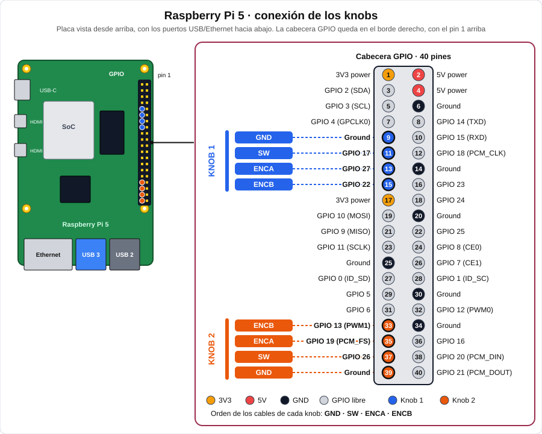
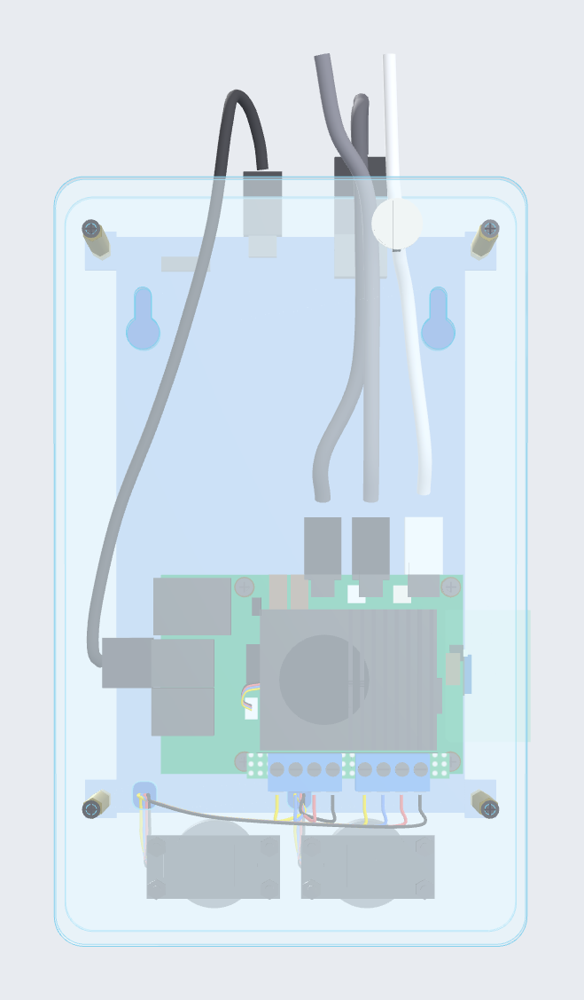
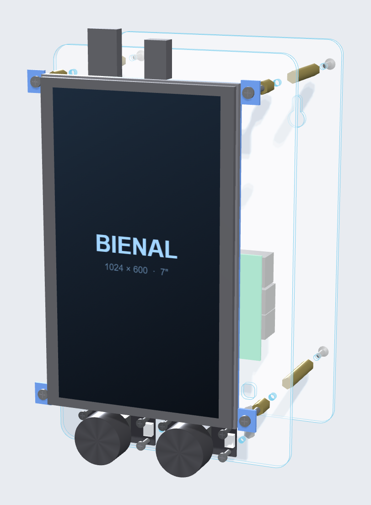
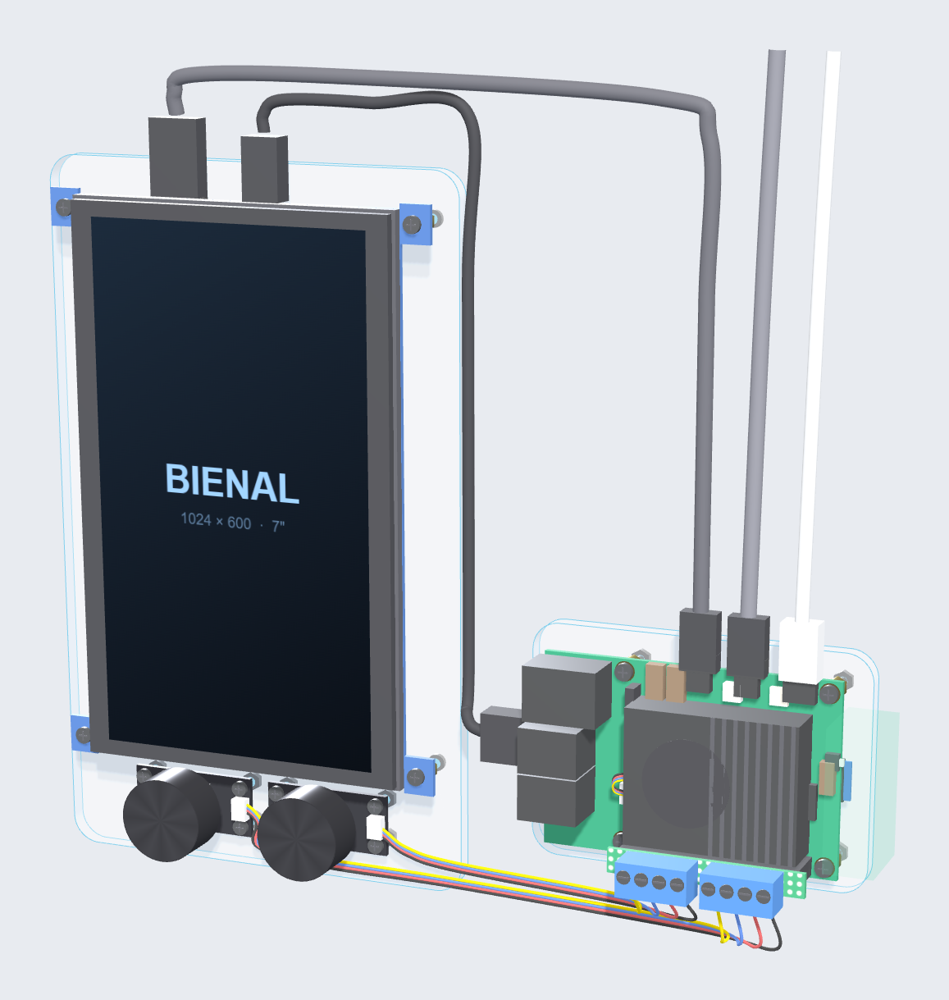
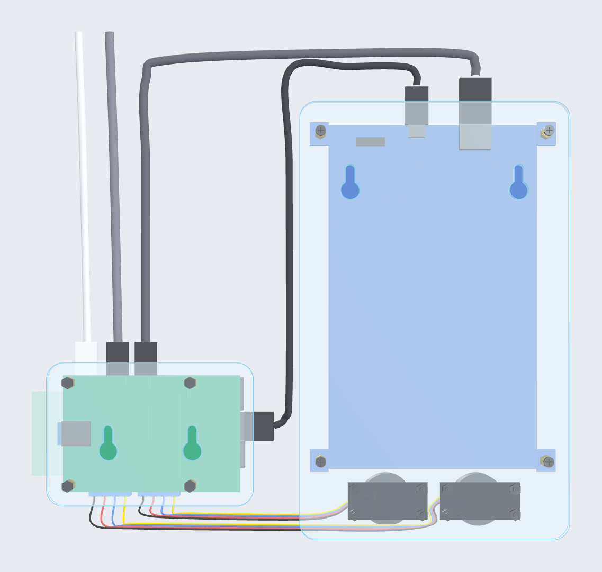

# Screen-Knobs

Pantalla táctil de 7" con **dos mandos giratorios** (encoder con pulsador) controlados por una **Raspberry Pi 5**.
Los sketches de **Processing** leen los mandos y los usan para manipular los visuales de la pantalla. Se incluyen dos formas de leer los mandos (Python y Java). El diseño de la carcasa es provisional.

---

## Funcionamiento del autostart

Al iniciar sesión en la Raspberry, el archivo `~/.config/autostart/p5.desktop` lanza el script `arrenca.sh`, que prepara las pantallas y abre los sketches.

**Desactivar:**

```
mv ~/.config/autostart/p5.desktop ~/.config/autostart/p5.desktop.disabled
```

**Volver a activarlo:**

```
mv ~/.config/autostart/p5.desktop.disabled ~/.config/autostart/p5.desktop
```

El cambio se aplica en el siguiente arranque.

---

## Contenido del repositorio

```
Screen-Knobs/
├── CARCASA/
│   └── carcasa_bienal_v2.html      Visor 3D interactivo de la carcasa (se abre en el navegador)
├── PYTHON/TestKnobPython/          Lectura de los mandos con Python (gpiozero)
│   ├── TestKnobPython.pde          Sketch principal (visuales)
│   ├── Knob.pde                    Lanza knob.py y recibe los valores
│   └── data/knob.py                Lee los GPIO y escribe "K1 5" / "K2 -3" por la salida estándar
├── JAVA/TestKnobJava/              Lectura de los mandos con Pi4J (Java)
│   ├── TestKnobJava.pde            Sketch principal (visuales)
│   ├── Knobs.pde                   Lectura de los GPIO con Pi4J
│   └── code/*.jar                  Pi4J 2.8.0 y SLF4J (Processing los carga solo)
└── docs/img/                       Capturas de la carcasa usadas en este README
```

---

<!-- Sección oculta de momento
## Hardware

| Pieza | Detalle |
|---|---|
| Raspberry Pi 5 | Con refrigerador activo oficial. Raspberry Pi OS 64 bits (Trixie), versión *sin* aplicaciones recomendadas |
| Pantalla | LCD HDMI 7" táctil (tipo Waveshare 7" C). Se usa girada 90° (vertical). *Pendiente de confirmar la resolución: el visor 3D indica 1024 × 600* |
| 2 × encoder | Pimoroni Picade Max Encoder: placa de 18 × 38 mm, agujeros M2,5 de 12 × 32 mm, conector JST-SH de 4 pines |
| Cables | 2 × JST-SH 4 pines → Dupont, micro-HDMI → HDMI, USB-A → micro-USB (táctil y alimentación de la pantalla), USB-C con fuente oficial de 27 W para la Pi |

El encoder no es I2C: aunque usa un conector JST-SH de 4 pines, no es compatible con Qw/ST, Qwiic ni STEMMA QT.
-->

---

## Conexión de los Knobs

Orden de los cables del encoder: **GND, SW, ENCA, ENCB**. Todos los pines de señal van con *pull-up* interno: el mando conecta el pin a GND.

**Mando 1** (pines físicos 9 a 15)

| Cable | Pin físico | GPIO (BCM) |
|---|---|---|
| GND | 9 | — |
| SW | 11 | 17 |
| ENCA | 13 | 27 |
| ENCB | 15 | 22 |

**Mando 2** (pines físicos 33 a 39)

| Cable | Pin físico | GPIO (BCM) |
|---|---|---|
| GND | 39 | — |
| SW | 37 | 26 |
| ENCA | 35 | 19 |
| ENCB | 33 | 13 |

**Esquema de conexión** (Raspberry Pi 5 vista desde arriba, con los puertos USB/Ethernet hacia abajo y la cabecera GPIO en el borde derecho):



Los dos programas usan exactamente estos pines (`K1: 27, 22, 17` y `K2: 19, 13, 26`, en el orden ENCA, ENCB, SW). Si un mando gira al revés, intercambia sus pines A y B en el código.

---

## Software

Pruebas de concepto: cada sketch es un test que dibuja un círculo: el **knob 1** cambia su tamaño y el **knob 2** lo mueve en horizontal; pulsar un mando vuelve su valor a 0.

Las dos versiones ofrecen lo mismo al sketch de Processing: `initKnobs()`, `closeKnobs()` y las variables `knobValue1` y `knobValue2`.

- El valor de cada giro del knob es un entero (positivo en sentido horario, negativo en sentido antihorario).
- Pulsar el botón del mando devuelve su valor a **0**.

El sketch de ejemplo suaviza los valores con `lerp()` y muestra FPS, memoria y los valores de los mandos en pantalla.

### Versión Python (`PYTHON/TestKnobPython`)

`Knob.pde` arranca `data/knob.py` como proceso hijo y lee su salida estándar en un hilo. `knob.py` usa **gpiozero** y escribe una línea cada vez que cambia un valor:

```
K1 5
K2 -3
```

- Si Processing se cierra, `knob.py` se cierra solo.
- Necesita `python3-gpiozero` (en Raspberry Pi OS con escritorio ya viene instalado). En una instalación mínima: `sudo apt install python3-gpiozero`.
- El sketch tiene `size(720,480)` activo y `fullScreen(P2D)` comentado, para pruebas en ventana.

### Versión Java (`JAVA/TestKnobJava`)

`Knobs.pde` lee los pines directamente con **Pi4J 2.8.0** (plugin gpiod, el necesario para la Pi 5). Un único hilo consulta los dos mandos cada 0,5 ms. Los `.jar` están en `code/` y Processing los carga automáticamente. El sketch usa `fullScreen()`.

### ¿Cuál usar?

| | Python | Java |
|---|---|---|
| Proceso extra | Sí (`python3`) | No, todo dentro de Processing |
| Archivos externos | Necesita `data/knob.py` | Solo los `.jar` de `code/` |
| Dependencia en la Pi | `gpiozero` | Ninguna (los `.jar` van incluidos) |
| Estrategia | Event-driven: callbacks de `gpiozero` (`when_activated`, `when_deactivated`) | Polling: un loop lee el estado de los pines |
| Threads | Varios, threads internos de la librería | Un único thread (`lectura-knobs`) para los dos knobs |
| Sincronización | `Lock` global en `knob.py` | No hace falta: todo ocurre en el mismo thread |
| Riesgo | El orden de los eventos entre knobs no está garantizado | Perder pulsos más cortos que el periodo de lectura (0,5 ms) |

La versión **Java** no depende de archivos externos, solo de los `.jar` que Processing incluye al exportar. Si se usa la de Python, hay que comprobar que `knob.py` viaja dentro de la exportación.

#### Si los dos knobs se mueven a la vez

- **Python:** los callbacks pueden ejecutarse en paralelo, desde threads distintos de la librería. Un `Lock` global serializa la actualización del contador y el `print` de cada línea (`K1 5`, `K2 -3`): cada knob cuenta bien y las líneas no se mezclan, aunque el orden entre knobs no está garantizado. En Processing, un thread lee el stdout de `knob.py` línea a línea y actualiza `knobValue1` y `knobValue2`.
- **Java:** no usa listeners. Un único thread llama a `knob1.leer(); knob2.leer();` cada 0,5 ms, siempre en ese orden. Si los dos knobs cambian a la vez, cada cambio se detecta en la siguiente vuelta del loop, sin concurrencia entre knobs.
- En las dos versiones, `knobValue1` y `knobValue2` son `volatile int`: el thread de `draw()` siempre ve el último valor.

---

## Carcasa (WIP - pendiente medidas exactas)

Carcasa abierta, sin caja: una plancha de metacrilato con la pantalla y los mandos por delante y la Raspberry por detrás, con su placa de prototipos (la Pi con la placa mide 27 mm de alto), y cerraduras para colgarla de la pared.

El archivo [`CARCASA/carcasa_bienal_v2.html`](CARCASA/carcasa_bienal_v2.html) es un visor 3D interactivo: se abre en el navegador, permite girar el modelo, ver la **explosión de montaje**, ocultar la pared y los cables, y consultar la lista de piezas con medidas (al pasar el cursor por una fila se resalta la pieza).

La opción elegida aparece en el visor como la variante **D**. Las medidas son las que da el propio visor (ancho × alto × fondo), sin cables.

### Opción 1 — 128 × 220 × 65 mm

Pantalla y mandos en una plancha frontal de metacrilato de 3 mm (128 × 208 mm). Los dos encoders van tumbados. La Raspberry va detrás, entre la plancha frontal y una placa trasera de metacrilato de 5 mm (mismo contorno), separadas por 4 separadores hexagonales M2,5 de 35 mm. La placa trasera lleva 2 cerraduras para colgarla de la pared. Los cables HDMI y micro-USB de la pantalla llevan conectores rectos y rodean el borde superior de la plancha.

Valorar poner pasacables (o bridas) por detrás de la pantalla, para fijar mejor los cables HDMI y USB. 


| Trasera | Explosión de montaje |
|---|---|
|  |  |

<!-- Opción 2 oculta de momento
### Opción 2 — 248 × 220 × 42 mm

La Raspberry va en una placa aparte, a la derecha y más abajo. La plancha de pantalla y mandos ya no necesita placa trasera: es una sola plancha de 5 mm que se cuelga con 2 cerraduras ocultas tras la pantalla, y la Pi tiene las suyas bajo su placa. 

Valorar: Cableado visible




-->
